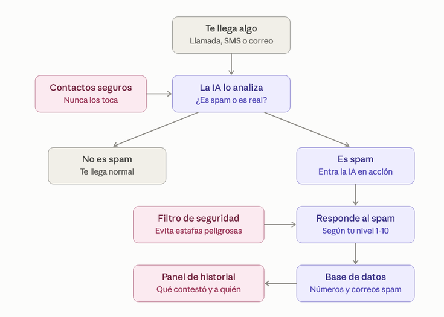

# REPO projecte-smx2a-2026-2027

Llista de projectes d'SMX2A del curs 2026-2027.

### AlmostReal

### GameTruk

### GymLeveling
Una polsera per a cada persona amb un identificador únic que serveix per entrar sortir i registrar-se en una màquina, després una lliga, amb rangs, la lliga és mensual i vas pujant llocs a mesura que guanyes punts els quals es guanyen fent la teva rutina, exercicis, reptes, Existeixen també reptes diaris i reptes setmanals, els reptes diaris et donarien el doble de punts i el setmanal el doble que el diari, El repte diari consistiria en una màquina segons la teva rutina, i el repte setmanal consistiria en una rutina d'un dia que pots fer cada setmana com per exemple un full body o fer cama full amb màquines que no s'usen, aquests reptes et donarien punts de lliga (els punts de lliga serveixen per pujar rànquing en lliga) i el setmanal et donaria punts de lliga i monedes( les monedes serveixen per quan en acumulis les suficients gastar-les en descomptes, productes, merchandising, etc.) cada dia si completes la teva rutina et donarien punts de lliga i monedes. Per a què serveix la lliga? Per incentivar la gent a anar al gym, en la qual si quedes en determinats llocs rebis diferents recompenses ex: top 1 títol exclusiu, -75% de descompte aquest mes, lot de proteïna i creatina i per exemple unes 50 monedes (les quantitats encara són indefinides), top 2 títol exclusiu, 25 monedes (les quantitats encara són indefinides), -50% de descompte aquest mes, lot de proteïna i creatina, top 3 títol exclusiu,15 monedes (les quantitats encara són indefinides), -25% de descompte aquest mes, lot de proteïna i creatina, top 4-10,10 monedes (les quantitats encara són indefinides). Important: els punts de lliga i les monedes de lliga són diferents (els punts de lliga es resetegen quan es reseteja la lliga i només serveixen per pujar llocs i guanyar les recompenses de lliga, després hi haurà experiència que et pugi de rang per fer exercicis i això un sistema normal d'experiència vaja). Finalment tenim una idea d'un sistema de ràtxa, en aquest hi ha dues diferents ràtxes, la primera ràtxa és de lliga, la qual es reseteja quan la lliga (aquesta no es reinicia quan falles un dia de rutina simplement aquest dia no compta i es queda en la mateixa ràtxa), (més ràtxa = més punts de lliga) l'altra ràtxa és una ràtxa general i aquesta es reseteja quan fallis un dia de la teva rutina (més ràtxa general = més monedes). Misions anuals i addicionals que apareixeran cada cert temps(les addicionals), les anuals consistiran en barbaritats (assisteix 100 dies al gimnàs o fes no sé quants km, etc.). Les addicionals en coses casuals (convida un amic amb aquest codi). Conseqüències: no portes polsera = no punts Cada màquina tindrà un sensor per tal que juntament amb la polsera detecti repeticions i pes, quantes voltes has fet a la bici, quants km i en quin temps has corregut a la cinta (tot això, evidentment, amb bona tècnica que serà detectada amb les càmeres… que aniran cap a una base de dades i un servidor que les recolliran i les posaran al rànquing, la lliga, etc. podràs tenir llista d'amics, lliga entre amics, lliga d'equips i la lliga global. Cada màquina tindrà el seu propi rànquing on sortiran els que més pes aixequin i més repeticions facin. La polsera també serà el mètode amb el qual pagaràs amb les monedes de l'aplicació, o sigui, tu t'apropes a la màquina expenedora i agafes un aquarius que val 50 monedes, doncs apropes la polsera, i pagues les 50 monedes.

Els productes que podràs aconseguir amb les monedes seran, begudes a la màquina expenedora, merchandising, proteïna, creatina, productes de gimnàs…

### IhateSpam
IHateSpam és un projecte d'una IA que s'encarrega de l'spam que us arriba, tant trucades i SMS com correus. Quan entra alguna cosa, la IA mira el número o el correu i decideix si és spam. Si no ho és, t'hi arriba com sempre. Si ho és, en comptes de bloquejar-lo li contesta ella sola.

Tu tries com contesta amb un nivell de l'1 al 10. Als nivells baixos és educada però els fa perdre el temps, als mitjans els vacil·la i els segueix el rotllo, i als alts es posa vora i els insulta.

Cada número o correu de correu brossa que detecta es guarda en una base de dades, així la propera vegada que tornin les reconeix al moment. A més, l'usuari pot crear una llista de contactes segurs, que són números i correus als quals la IA mai no respon, perquè no conteste per error la teva família, el teu banc o la teva feina. També porta un filtre de seguretat: si alguna cosa sembla una estafa perillosa, com un phishing, la IA no contesta per no donar dades ni confirmar que el teu número funciona.

Tot això va a una web i una aplicació. Des d'aquí es veu un historial de quin correu brossa ha arribat, què ha respost la IA i quant de temps els ha fet perdre.

### La-Fusta-Lactea

### MyBread

### OfAI

### LucasProject
