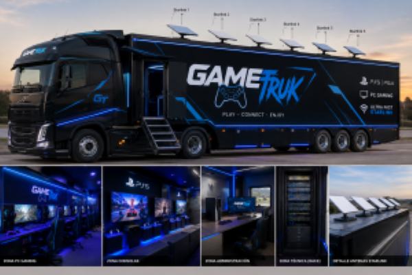
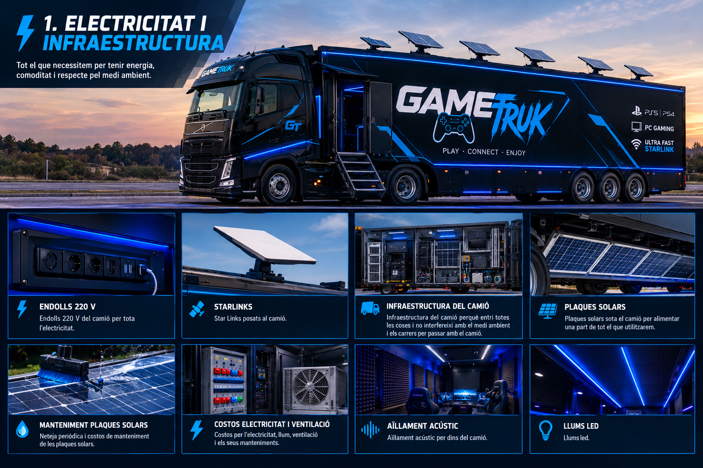
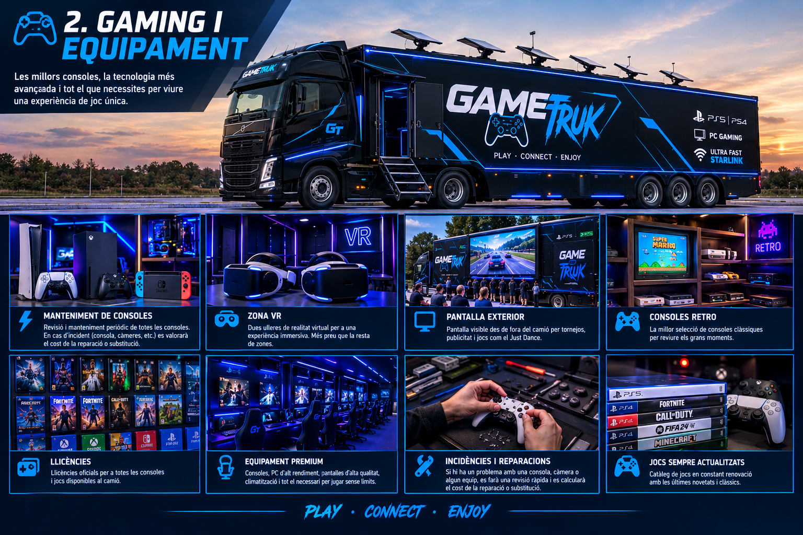
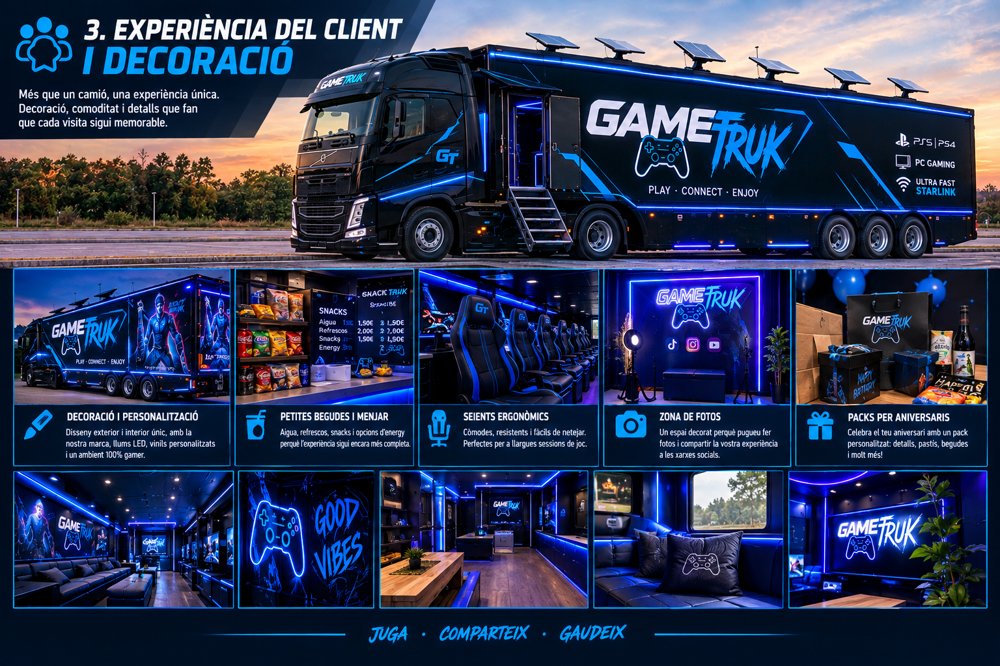
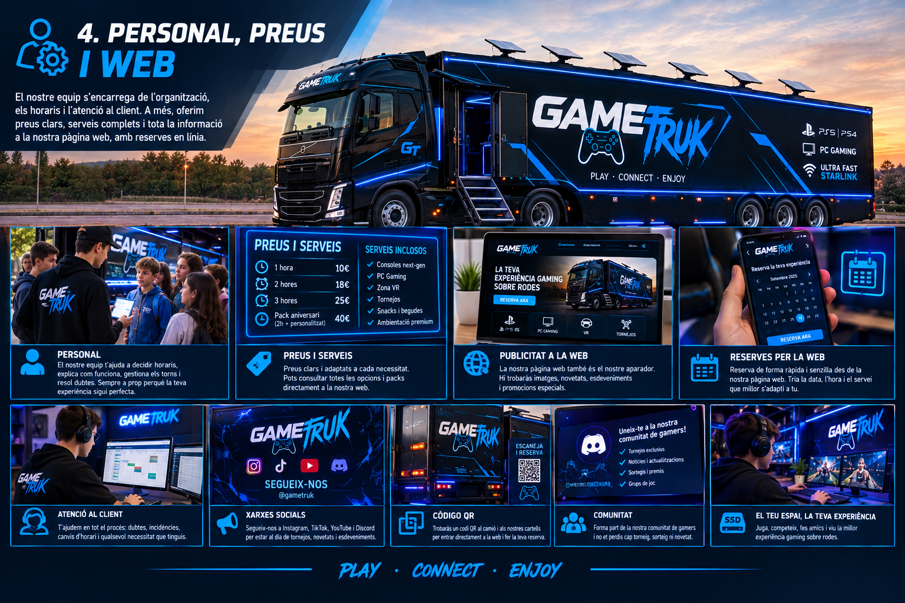

# REPO projecte-smx2a-2026-2027

Llista de projectes d'SMX2A del curs 2026-2027.

### AlmostReal

### GameTruk
Aquest projecte consisteix en el disseny i la implementació d’un GAME TRUCK, un camió adaptat com un espai d’entreteniment i videojocs . L’objectiu principal és crear un entorn on els usuaris puguin gaudir de diferents videojocs amb amics, utilitzant consoles com PlayStation 4 i PlayStation 5, ordinadors gaming i altres dispositius.

El GAME TRUCK disposarà d’una infraestructura informàtica completa, formada per una xarxa local d’alta velocitat, servidors, equips informàtics, consoles, sistemes de comunicació i diferents serveis de xarxa.

Per proporcionar una connexió a Internet estable i amb una capacitat elevada, ens plantegem la utilització de sis connexions Starlink de fins a 300 Mbps cadascuna. Aquestes connexions es gestionaran mitjançant un servidor basat en Ubuntu Server, utilitzant la tècnica de Channel Bonding per combinar diverses interfícies de xarxa i distribuir el trànsit entre les diferents connexions disponibles.

La infraestructura de xarxa estarà formada principalment per un servidor central, switches, punts d’accés Wi-Fi i connexions Ethernet. Els ordinadors gaming i altres dispositius que necessitin una connexió estable es connectaran preferentment mitjançant cable Ethernet, mentre altres equips podran utilitzar la xarxa Wi-Fi.

Com a sistema operatiu principal dels servidors utilitzarem Ubuntu Server, basat en el kernel Linux. Aquest sistema permetrà gestionar diferents serveis de xarxa, usuaris, permisos, seguretat, monitorització i administració de la infraestructura.

(Electricitat i Infraestructura)

Endolls 220 V del camió per tota l’electricitat.
Star Links posats al camió.
Infraestructura del camió perquè entri totes les coses i no interfereixi amb el medi ambient i els carrers per passar amb el camió.
Plaques solars sota el camió per alimentar una part de tot el que utilitzarem.
El manteniment de les plaques solars amb neteja periòdicament i costos.
Els costos per l’electricitat, llum ventilació i els seus manteniments.
Aïllament acústic per dins del camió.
Llums led.

(Gaming i Equipament)

El manteniment de les consoles i si surten incident per exemple un mal fet amb una consola o una cosa amb càmeres i costos per l'incident
Zona Vr amb ulleres realitat virtual x2 que sortirà més de preu
Pantalla visible fora del camió pels següents tornejos, posar publicitat o per jocs com el Just Dance.
Consoles retro.
Llicències per les consoles i també pels jocs que hi hagin.

(Experiència del Client i Decoració)

Decoració i personalització del camió per fora i per dins.
Petites begudes i menjar, snacks per la gent.
seients ergonòmics fàcils de netejar i còmodes per la gent.
Lloc on la gent pugui fer fotos per les xarxes socials.
Packs per la gent que compleix anys amb coses personalitzades.

(Personal, Preus i Web)

Personal per parlar amb la gent decidir horaris, quan juga la gent i els preus que costarà per hora jugada dins del camió.
Preus i serveis.
Publicitat dins de la pàgina web.
Reserves directament per la pàgina web.

### GymLeveling
Una polsera per a cada persona amb un identificador únic que serveix per entrar sortir i registrar-se en una màquina, després una lliga, amb rangs, la lliga és mensual i vas pujant llocs a mesura que guanyes punts els quals es guanyen fent la teva rutina, exercicis, reptes, Existeixen també reptes diaris i reptes setmanals, els reptes diaris et donarien el doble de punts i el setmanal el doble que el diari, El repte diari consistiria en una màquina segons la teva rutina, i el repte setmanal consistiria en una rutina d'un dia que pots fer cada setmana com per exemple un full body o fer cama full amb màquines que no s'usen, aquests reptes et donarien punts de lliga (els punts de lliga serveixen per pujar rànquing en lliga) i el setmanal et donaria punts de lliga i monedes( les monedes serveixen per quan en acumulis les suficients gastar-les en descomptes, productes, merchandising, etc.) cada dia si completes la teva rutina et donarien punts de lliga i monedes. Per a què serveix la lliga? Per incentivar la gent a anar al gym, en la qual si quedes en determinats llocs rebis diferents recompenses ex: top 1 títol exclusiu, -75% de descompte aquest mes, lot de proteïna i creatina i per exemple unes 50 monedes (les quantitats encara són indefinides), top 2 títol exclusiu, 25 monedes (les quantitats encara són indefinides), -50% de descompte aquest mes, lot de proteïna i creatina, top 3 títol exclusiu,15 monedes (les quantitats encara són indefinides), -25% de descompte aquest mes, lot de proteïna i creatina, top 4-10,10 monedes (les quantitats encara són indefinides). Important: els punts de lliga i les monedes de lliga són diferents (els punts de lliga es resetegen quan es reseteja la lliga i només serveixen per pujar llocs i guanyar les recompenses de lliga, després hi haurà experiència que et pugi de rang per fer exercicis i això un sistema normal d'experiència vaja). Finalment tenim una idea d'un sistema de ràtxa, en aquest hi ha dues diferents ràtxes, la primera ràtxa és de lliga, la qual es reseteja quan la lliga (aquesta no es reinicia quan falles un dia de rutina simplement aquest dia no compta i es queda en la mateixa ràtxa), (més ràtxa = més punts de lliga) l'altra ràtxa és una ràtxa general i aquesta es reseteja quan fallis un dia de la teva rutina (més ràtxa general = més monedes). Misions anuals i addicionals que apareixeran cada cert temps(les addicionals), les anuals consistiran en barbaritats (assisteix 100 dies al gimnàs o fes no sé quants km, etc.). Les addicionals en coses casuals (convida un amic amb aquest codi). Conseqüències: no portes polsera = no punts Cada màquina tindrà un sensor per tal que juntament amb la polsera detecti repeticions i pes, quantes voltes has fet a la bici, quants km i en quin temps has corregut a la cinta (tot això, evidentment, amb bona tècnica que serà detectada amb les càmeres… que aniran cap a una base de dades i un servidor que les recolliran i les posaran al rànquing, la lliga, etc. podràs tenir llista d'amics, lliga entre amics, lliga d'equips i la lliga global. Cada màquina tindrà el seu propi rànquing on sortiran els que més pes aixequin i més repeticions facin. La polsera també serà el mètode amb el qual pagaràs amb les monedes de l'aplicació, o sigui, tu t'apropes a la màquina expenedora i agafes un aquarius que val 50 monedes, doncs apropes la polsera, i pagues les 50 monedes.

Els productes que podràs aconseguir amb les monedes seran, begudes a la màquina expenedora, merchandising, proteïna, creatina, productes de gimnàs…

### IhateSpam

### La-Fusta-Lactea

### MyBread

### OfAI

### LucasProject
